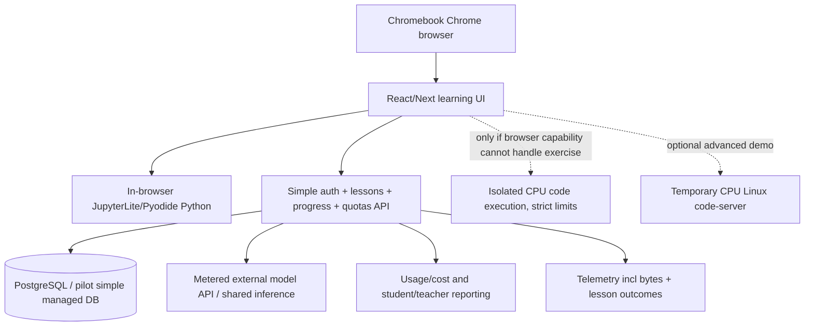

# Chromebook Opportunity — AI Skills Lab MVP & Demo Plan
**Date:** 2026-10-27  
**Status:** Proposed *single-product* MVP. This document does not claim implementation, funding, public-program access or government/telecom partnership approval.  
**Read with:** [Master Platform](PLATFORM_MASTER_PLAN_2026-10-26.md), [Joint funding / AI Workspace strategy](SHARED_FUNDING_AV1_AI_DESKTOP_STRATEGY_2026-10-27.md), [Handover](PLATFORM_HANDOVER_RUNBOOK_2026-10-26.md).

## 1. Verified market catalyst versus addressable customers

- Pakistan PM Youth Chromebook Scheme publicly launched **2026-10-25** with **500,000 refurbished Chromebook** distribution target and **MiFi devices / high-speed internet connectivity**. Government statement indicates distribution over **two years**, while separate media eligibility reporting mentions three years. These are **planned devices**, not 500,000 installed paying users.
- 2026-10-27 verified scheme references:
  - Government Ministry of Information: https://www.moib.gov.pk/News/66488
  - Radio Pakistan: https://radio.gov.pk/25-10-2026/pm-formally-launches-youth-chromebooks-scheme
  - News/age/eligibility: https://www.geo.tv/latest/688190-pm-chromebook-scheme-everything-you-need-to-know
  - Official school-student eligibility/portal: https://pmychromebooks.ibcc.edu.pk/
- The scheme's government application portal emphasizes Grade 9/10 *government/public school* academic-merit eligibility, whereas some broader news coverage refers to additional recipient types. Do not claim all 500k are university coders or authorized commercial customers. Confirm with MoFEPT/IBCC for pilot enrollment/eligibility.
- No evidence establishes **actual distributed device model(s), their support expiration, memory/CPU, MiFi data allowances, funded applications, Jazz as MiFi carrier, school-managed Chrome URL policy, or availability of student personally identifiable information to vendors**.
- Google policy references: https://support.google.com/chromebook/answer/7052113 (check AUE), https://support.google.com/chrome/a/answer/7532419 (school domain/URL allow-block). Obtain a **real distributed refurbished Chromebook** before making hardware compatibility and bandwidth claims.
- Opportunity estimate: 500k is a *top-of-funnel eligibility ceiling*. Example 2% uptake -> 10k potential users only **if** all devices are delivered, allowed to use the site, reached by our partner, active, and sponsored/paid. NOT a forecast, contract or TAM monetization proof.

## 2. Decision: one product, one buyer, one hero experience

**Product:** **Cloud AI Skills Lab** — browser-based guided coding/STEM exercises for Grade 9–10 students, with a constrained bilingual AI tutor, authentic Python code run, progress assessment, sponsor/teacher reporting and optional *on-demand CPU* remote development workspace.

**First payer:** school / authorized education NGO / corporate CSR sponsor / education or telecom operator. **Students are not assumed to pay.** Do not market unregulated consumer GPU gaming to minors as a component of the education distribution program.

**Why it should exist:** teach and measure a complete guided outcome (e.g., "I programmed a calculator and understood errors"), not merely substitute for free Google Docs/Gemini/Colab. Value for sponsor: curriculum-aligned content, implementation help, safe-cost-capped tutor, evidence of participation and progress.

**MVP hero success metric:** a student on an actual low-end Chromebook can **complete one lesson with a correct Python program and receive appropriate feedback**, while a teacher dashboard records completion, duration and anonymized usage/cost. The same demo should work on ordinary Chrome on a laptop, but Chromebook device validation is a separate exit gate.

### MVP IN
1. HTTPS browser/PWA-like student dashboard with simple test login, English/Urdu for tutor prompts and one interactive lesson.
2. Beginner Python calculator lesson: explanation, adjustable inputs, run/check feedback, final short quiz, save/restore progress.
3. *Local browser Python* via JupyterLite/Pyodide or a comparable secure in-browser sandbox where supported; capability-based fallback to an isolated server-side **CPU** execution environment for incompatible older ChromeOS browsers.
4. **Teacher-scoped AI assistant** with lesson context, safe prompt limits, hint-first behavior, per-user and per-sponsor quota, request audit and cost monitoring. No unlimited free-form chatbot or unapproved model fine tuning with child data.
5. Teacher/sponsor dashboard: invited users, lesson completion, task errors, AI requests/tokens, aggregate engagement and bytes transferred. Avoid giving sponsors sensitive personal profiles.
6. Secure bounded demo sessions (pilot tenant, rate limiting, idle TTL, log redaction and cost cap).
7. Optional *technical preview* button "Open full cloud IDE": demonstrate ephemeral Linux VS Code/code-server desktop for one student **only after basic lesson success**; not necessary for first ship and not a GPU desktop.

### MVP OUT
Consumer AAA cloud gaming subscription, full Moonlight/WebRTC gaming player, expensive GPU fleet, esports, Unity/Blender streaming, paid marketplace, wallet/token/staking, unattended LLM agents, unrestricted cloud coding shell, full school MIS, nationwide government integration or all-platform native applications.

The client Moonlight/Sunshine work stays maintained and versioned separately; it is **not** blocked or rewritten to deliver the Chromebook experiment.

## 3. Five-minute REAL device demonstration

| Clock | Live action | What it proves |
|---|---|---|
| 0:00–0:45 | Open a **real scheme Chromebook** or documented closest-equivalent device; connect via actual MiFi; visit public HTTPS demo page; demo login | No APK or special setup; Wi-Fi/MiFi availability and browser compatibility |
| 0:45–2:10 | Choose "Build a Python Calculator"; follow teacher-authored steps; type code, press Run and see valid numeric output | Guided learning, running code on low-end device, responsiveness |
| 2:10–3:20 | Introduce an error; ask bounded Urdu/English AI tutor "why?" and receive a *hint*; fix code; run final assessment | AI helps learn rather than gives unassessed answers; logs token use |
| 3:20–4:10 | Refresh/browser close/reopen; progress remains, learner sees completed badge | Persistence and session identity |
| 4:10–5:00 | Switch to teacher/CSR sponsor dashboard; show actual completed task, AI requests, byte count, approximate cost/student | Buyer-facing value, accountability and unit costs |

**Optional 60-second technical appendix:** on a separate URL/single verified CPU worker, open an isolated full cloud IDE via code-server with approved code example. It proves a Chromebook can access a more powerful workspace but is not needed for the education product's first milestone.

**Show the measured metrics, not an animation:** device model and ChromeOS update schedule; CPU/RAM if available; first-content-load bytes, cache size, time to lesson, Python run latency, AI response latency, MiFi upload/download, progress write success, and teacher-report consistency. Do not show private student names/IDs. Record demo with demo-only identities and consent.

## 4. Lean technical architecture

- **Static lessons/client:** CDN or static hosting with cached browser assets. Avoid sending real-time video: most AI tutor exchange is text and few KB per interaction.
- **Python execution:** use WebAssembly/Web Worker environment such as JupyterLite Pyodide, with explicit memory/time limits; package size and older device/browser compatibility must be measured. Sources: https://jupyterlite.readthedocs.io/en/stable/ and https://jupyterlite.readthedocs.io/en/stable/howto/configure/kernels.html
- **Server-side fallback:** isolated per-exercise CPU runner, no outbound arbitrary Internet, filesystem or host shell exposure; quotas and TTL. Do not execute untrusted code directly in web application API process.
- **Optional full CPU code workspace:** code-server https://github.com/coder/code-server; authenticated per-student isolated container/VM with filesystem namespace, WebSocket routing and container cleanup. Avoid unrestricted shell access for minors; supervised/admin mode for demos only.
- **Back end:** lean FastAPI/.NET/Go or existing maintained backend, not premature cluster of microservices; object-store artifacts/metrics and relational progress DB.
- **Education policy:** consent appropriate to age and jurisdiction, school contract, guardian/teacher controls, data minimization and retention/deletion, age-appropriate AI guardrails, restricted model prompts and no training on student conversation data without permission.

## 5. MVP demo cost and infrastructure envelope

**No GPU required.** Existing AWS CPU staging can host the app under budget; AWS Lightsail reference examples include $24/mo for Linux 4GB/2vCPU and $44/mo for 8GB/2vCPU (pricing varies by region/plan; CPU burst limits matter). Source: https://aws.amazon.com/lightsail/pricing/ . JupyterLite Python runs in browser, reducing dedicated execution capacity. Static content could run through cheaper static hosting.

Suggested **demo expense authorization ceiling:** $50–150 for the first 30-day internal prototype **excluding staff engineering time**, sized for a handful of concurrent testers and carefully limited AI API requests; this is not a production capacity quote or promise. Explicitly cap API tokens, CPU usage, and network costs. For a larger 200–500 student pilot, request actual concurrency and data measurements first; a $44 server **cannot be assumed** to host 200 concurrent Linux IDEs.

### Illustrative education sponsorship unit economics (NOT sales proof)
| Driver | Hypothesis |
|---|---:|
| Sponsored/enrolled seats | 500 |
| Price paid by school/CSR/operator | PKR 250 per enrolled student/month |
| Recognized billed revenue | PKR 125,000/month |
| Web/CPU hosting, CDN/database | PKR 20,000/month |
| Capped tutor model API | PKR 20,000/month |
| Direct content ops / teacher onboarding | PKR 15,000/month |
| Direct support/usage audits | PKR 15,000/month |
| Direct COGS total | PKR 70,000/month |
| **Direct contribution** | **PKR 55,000/month (44%)** |

Prices, concurrent participation, AI model choice and costs are not validated. Excludes initial product development, sales/government procurement, central R&D, taxes, refunds and broader overhead. A flat price/seat works only with explicit AI quotas and no unconstrained remote CPU desktop entitlement. Sponsor may instead buy a fixed 6–12 week training cohort; procurement economics and KPI/payment terms could differ.

**Most important economy:** measured price per learner who actually completes a lesson, not just per Chromebook issued or logged-in count. If no sponsor buys, installed users imply zero B2B revenue.

## 6. Implementation stages and acceptance gates

| Stage | Suggested work | Gate |
|---|---|---|
| Discover (2–3 working days indicative) | Obtain 1 real Chromebook, confirm ChromeOS version/model/AUE/memory, MiFi carrier/quota, browser website policy, target Grade 9 Python content and sponsor | Real device + named education buyer/access |
| Demonstration build (5–10 engineering days indicative) | One browser lesson, Python execution, hint-first tutor, demo login/progress, read-only teacher panel, minimal backend | Five-minute full flow on Chrome, recorded costs |
| Field device proof (3–5 testing days) | Low-end Chromebook test on MiFi, 10–20 simultaneous users, older AUE/managed restrictions, API spend limits | No fatal browser/login/code failures; actual bandwidth and latency numbers |
| Paid validation (6–12 week cohort proposal) | 100–300 verified students, teacher supervision and sponsor, reporting and pre/post learning test | Signed pilot terms, activation/completion/outcome and cost per active/completer |
| Expansion (conditional) | More curriculum, multi-school tenant, supervised CPU remote labs, optional professional/creator desktop and gaming | Funded use case and isolation/cost validation |

**Stage timing is only sequencing—not a delivery promise.** Do not imply demo exists today.

### Pilot KPIs (targets, not current results)
- % students who sign in with issued demo credentials; target >70% of invited cohort under teacher-led onboarding.
- First lesson completion rate; provisional target >60% of those starting, measured by cohort and device type.
- Correct-code completion without a copied answer; teacher-reviewed sample.
- Median/p95 lesson load and AI hint time on actual MiFi; set thresholds only after first 10–20 device tests.
- Actual app MB/student/session including cold browser download.
- Model token cost / active user / lesson completed; cap per-user and total monthly spend.
- Pilot sponsor value: education outcomes and privacy compliance, not AI token consumption.

## 7. Partner pitch and funding map

**Our platform:** education product/IP, browser experience, AI tutor/prompt policy, learning analytics, capability routing to cloud workspaces.

**Sky47:** optional local CPU VM/container hosting, safe workspace infrastructure, later premium GPU courses. A GPU-fleet sale should **not** be asserted from this CPU-first pilot.

**Jazz or another carrier:** subsidized/zero-rated *subject to agreement* access to a low-bandwidth learning site, MiFi service if selected as actual provider, CSR/digital inclusion sponsorship, retail education bundle. **No evidence confirms Jazz is the network provider for this Chromebook scheme.**

**Ministry/education administrators / supply foundation:** possible pilot evaluator/sponsor, not a confirmed customer. Scheme governance, procurement, public-school eligibility, data policy and tender compliance apply.

**Commercial offer:** sponsor funds a fixed trial cohort, not student subscription from minors. The government distribution target is a market discovery event, not a procurement award.

## 8. Immediate next actions / owner groups

| Work ID | Action | Owner type | Evidence |
|---|---|---|---|
| EDU-001 | Obtain actual distributed Chromebook specs, AUE and MiFi quota | Partnerships/QA | Device test sheet and pictures sans IDs |
| EDU-002 | Confirm public school/student consent/sponsor entry point | Partnerships/legal | Named pilot school/sponsor and permissions |
| EDU-003 | Build one branded browser lesson with Python execution | Frontend | Runnable URL, Python calculator output |
| EDU-004 | Implement lesson-scoped bilingual AI tutor and cost ceiling | Backend/AI | Prompt logs redacted, spend quota and tests |
| EDU-005 | Implement progress events and teacher read-only reporting | Backend/UI | Same output visible across refresh/user/teacher |
| EDU-006 | Run old-ChromeOS/MiFi network acceptance matrix | QA | Actual data bytes, p95 and browser version |
| EDU-007 | Quote 100–300 student pilot cohort, confirm who pays | Product/Finance | Sponsor letter/paid SOW and expense cap |
| EDU-008 | Decide if demo optional code-server workspace actually improves sponsor conversion | Product/QA | Time-on-task, incremental cost and buyer feedback |

## 9. Safeguards against doing too many things

- **One buyer:** education sponsor/institution, not consumer gamer.
- **One audience:** school-age Chromebook recipients.
- **One task:** complete introductory Python exercise with an accountable, constrained AI tutor.
- **One device path:** browser on ChromeOS.
- **One success:** measured lesson completion and teacher-visible output with cost ceiling.
- **One first funding gate:** real device + pilot sponsor and permission, not hundreds of gaming GPU seats.
- Prior native Android game streaming project remains separate and can become a later premium product, with no paid GPU enabled just for the Chromebook demo.
- If buyer wants video/game streaming as the *main* deliverable, require a separate approved product/rights/economics decision instead of silently expanding this MVP.

## 10. Handover prompt
> We are responding to Pakistan's 2026-10-25 announced 500,000 refurbished Chromebook + MiFi educational program. This is a target rollout, not installed users; official eligibility and device specs/policies must be verified. Build **one** browser-based `Cloud AI Skills Lab` demo for Grade 9 students: beginner Python lesson, run code, Urdu/English hint-first tutor, saved progress and sponsor dashboard. Prefer browser-side execution and minimal CPU cloud; **no GPU fleet, streaming, gaming, blockchain or full AI desktop** in MVP. Obtain a real Chromebook and MiFi for field validation. Follow EDU-001–EDU-008; measured proof and sponsor demand are required before scaling. Keep Android client canonical handoff intact. Treat Jazz/Sky47 and government procurement as *potential*, not contracted. This document is a proposed MVP specification, not a deployed build.
