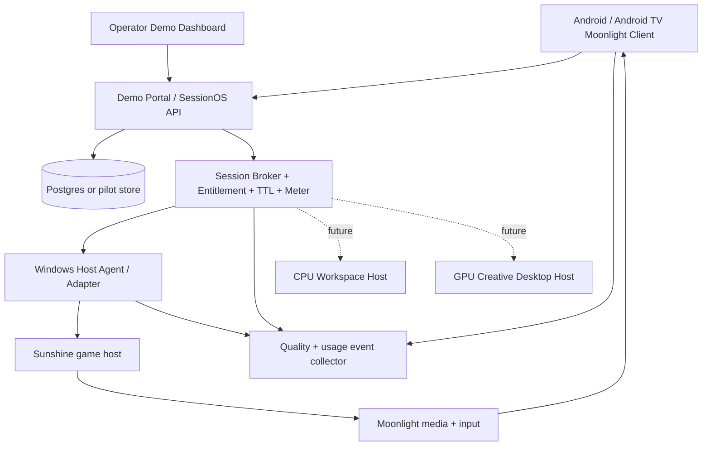

# Gaming-first MVP — From Local Moonlight Proof to Partner Demo and GPU-on-Demand Desktop

> **Transport separation:** The future CPU desktop may use browser-based RDP/WebRTC or another efficient desktop protocol. It does not automatically inherit Moonlight streaming because CPU-only virtual machines may lack suitable hardware encode/display; assess guest OS, software encode cost and low-bandwidth user experience. Gaming/GPU workstation use Moonlight/Sunshine-compatible hardware encoding where proven. The **shared asset** is SessionOS identity, allocation, policy, metering and host abstraction, not one mandatory codec for all workloads.

**Date:** 2026-10-27  
**Decision status:** **ACTIVE proposed product direction**; approval to buy GPUs, host licensed games or distribute consumer service is **not** implied.  
**Canonical client evidence:** [CANONICAL_HANDOFF_2026-10-23.md](CANONICAL_HANDOFF_2026-10-23.md)  
**Program handover:** [PLATFORM_HANDOVER_RUNBOOK_2026-10-26.md](PLATFORM_HANDOVER_RUNBOOK_2026-10-26.md)  
**Financial hypotheses:** [PAKISTAN_SKY47_JAZZ_TRIPARTITE_ECONOMICS_2026-10-27.md](PAKISTAN_SKY47_JAZZ_TRIPARTITE_ECONOMICS_2026-10-27.md)

## 0. Executive decision, including reversal of the Chromebook pivot

**MVP = Cloud Gaming**, not school learning, a general AI desktop, all-platform browser play, or a multi-GPU farm. The 2026-10-27 Chromebook "AI Skills Lab" proposal is now **DEFERRED / NOT the active MVP** after product review; preserve that document only as an archived exploration, not as instructions to build.

**Future expansion:** same SessionOS/session-account/billing/host abstraction should later allow:
1. CPU remote desktop for low-intensity office, browser and coding work;
2. GPU-backed interactive workstation for creative/3D/CAD/AI applications that genuinely need graphics/inference capacity;
3. optional batch/private model inference as a *distinct* non-streaming job product.

We do **not** create a separate Chromebook-specific product, Python curriculum, school portal, token economy, publisher game store, browser full-featured gaming client, or custom GPU driver for the first demo.

**Commercial positioning:** a partner-deployable, white-label cloud-gaming service that can later operate other interactive workloads. Candidate roles: platform company (software/IP), Sky47 (host/capacity), Jazz (distribution/network/billing), none of which is a confirmed contract.

## 1. Existing assets (reuse; do not restart)

**CONFIRMED by the dated client handoff:**
- A branded Moonlight Android app in `atifbukhari/Cloud-Gaming-Client`, branch `demo-client-v1`.
- Full local **Android TV emulator** to Windows Sunshine `SuperTuxKart` run: pairing, catalog, first frame, session telemetry, Disconnect (keeps game), Resume, End Game (Sunshine quit). 12.2-demo2 is a retained proven rollback checkpoint.
- Subsequent 12.3-demo2 app enhancements: focused game hero, in-stream menu, TV QR phone controller and per-game profiles; build/CI green, **physical phone/TV E2E still not recorded**.
- Physical Android ADB authorization was reported, but actual live device and current APK install have not been verified at this time.
- Scripts and docs: `tools/validate-android-device.ps1`, `docs/PHYSICAL_ANDROID_VALIDATION.md`, `docs/STREAM_PROFILES.md`, `docs/CI_BUILD_STRATEGY.md`.
- Previous Linux/AWS headless capture black-screen path remains **unresolved**; should not block testing a separate authorized Windows GPU host.
- AWS GPU should remain OFF until there is approved test budget, TTL, shutdown and clear evidence scope.

**Candidate, not production-approved:** Sunshine (known baseline), Vibeshine (separate Windows host lab), LuminalShine/D2E (later research), AV1 codecs (hardware/encoder compatible only), SessionOS (not yet deployed).

## 2. MVP user journey — one paid-or-demo gaming session

```
Open Android TV or Android mobile app
 → see branded game catalogue
 → choose an authorized game
 → check demo entitlement (guest time grant or signed user)
 → START / request one gaming-capable host
 → GPU game host becomes READY; code handles cold-start timeout
 → client connects to approved Sunshine/game host
 → game starts; actual first video frame and input verified
 → play with Bluetooth controller or TV QR phone as controller
 → in-stream view of quality/session timer
 → Disconnect (short reconnect grace period) or End Game
 → session meter finalized; host game/process/input/display cleaned
 → operator/partner dashboard shows playable minutes, quality, GPU occupancy and cost
```

The **session broker must not fake READY** based only on an active process; it requires verified capture and stream readiness where measurable. Auth credentials are short-lived and bound to session and host.

## 3. What is IN versus OUT

| IN for demo/MVP | OUT until funded/validated |
|---|---|
| Android TV/Android phone install, game hero, Play/Resume, Exit | New Windows/iOS/ChromeOS clients |
| 1–3 authorized titles, with SuperTuxKart technical control | Unlicensed AAA game catalogue / cloud DRM bypass |
| 1 active host/session initially, growing to 2 independent sessions | Multiple unrelated users per Windows login or magic 8-sessions/GPU |
| Local Windows Sunshine host then one GPU-backed remote worker | New proprietary streaming codec or kernel display driver |
| Basic user/demo login and entitlement (hard time/usage caps) | Full Jazz SIM/charging integration before pilot |
| Small SessionOS: host registry, leases, allocation, timeout, cleanup | Global Kubernetes, multi-region geo-scheduler |
| QR phone-controller E2E; gamepad support | General multi-controller/competitive multiplayer platform |
| H264 baseline; HEVC/AV1 A/B when supported | Force AV1 on older Android TV clients |
| Operator demo screen: user, sessions, first frame, usage, net quality | Full white-label marketplace, ads, esports, wallets |
| Resource type/policy field supporting later DESKTOP_CPU/DESKTOP_GPU | Shipping actual AI desktop as a separately priced product |
| Tested teardown, GPU TTL and unit-cost export | Paid commercial launch without publisher/OS/cloud rights |

**Phase 1 vs MVP:** show a future desktop **technical preview only** by launching an authorized desktop application on the same existing GPU host, not by claiming that CPU VM→GPU VM seamless migration or dynamic GPU hotplug exists. Actual CPU vs GPU workspace broker is a later product.

## 4. Minimum viable software layout



For a truly minimal single-host demo, a secure control API and poll/long-poll host adapter can run in the same service. Do not force a distributed architecture for one host. Make the API schema and identity handling production-upgradable without implementing full tenant scaling now.

### MVP SessionOS contract

User-facing:
```http
POST /v0/demo/entitlements            # short time-limited demo grant, restricted admin path
GET  /v0/catalog                      # authorized installed titles
POST /v0/sessions                     # gameId, resourceClass=GAME_GPU, idempotency key
GET  /v0/sessions/{id}                # provisioning → ready → streaming → reconnectable → closed
POST /v0/sessions/{id}/connect        # short-lived connection info/stream grant
POST /v0/sessions/{id}/disconnect     # keep game only within bounded grace period
POST /v0/sessions/{id}/end            # idempotent terminate/cleanup
GET  /v0/admin/sessions               # role-protected limited demo reporting
```
Host-agent internal:
```text
register(hostId, capabilityManifest, signedAgentIdentity)
heartbeat(hostId, gpu/encoder/game/display state)
prepare(sessionId, gameId, deadline)
launch(sessionId, gameId)
getHealth(sessionId)
terminate(sessionId)
cleanup(sessionId)
```

Proposed resource class data model:
```json
{
  "session_id": "uuid",
  "tenant_id": "pilot-tenant",
  "resource_class": "GAME_GPU",
  "application_id": "supertuxkart",
  "required_capabilities": {
    "hardware_encoder": true,
    "supported_codecs": ["h264", "hevc", "av1"],
    "gpu_vram_gb_min": 4,
    "resolution": "1280x720",
    "target_fps": 60
  },
  "lease_ttl_seconds": 1800,
  "disconnect_grace_seconds": 120
}
```
All values are **example policy**, not an assertion every machine runs AV1/4GB. In production the host advertising `av1` does not prove the client supports AV1; negotiate codec intersection and benchmark. Short demo TTLs should be configurable and clearly displayed.

Future `resource_class` values:
- `DESKTOP_CPU`: isolated CPU workspace, no mandatory dedicated GPU;
- `DESKTOP_GPU`: isolated workstation requiring specific supported GPU/driver/vGPU/OS app/license;
- `AI_INFERENCE`: separate API job with token/compute ledger, no stream needed.

**Critical nuance:** GPU-backed sessions may require a **new allocated VM/session**; never promise live addition/removal of GPU to an existing virtual desktop without proven hypervisor/device migration support. Preserve files/settings through authorized persistent storage and resume in the new workspace.

## 5. Two-stage demonstration — never begin with paid GPU

### Demo A: available **now** on the existing local Windows/Sunshine test station
- Install latest proven custom APK to **physical Android phone** via ADB, confirm current version/clock/hardware decoder.
- Open branded game-first catalogue, launch SuperTuxKart, demonstrate menu, telemetry, Disconnect→Resume→End Game.
- Run TV/phone companion QR when physical TV or Android TV test device exists.
- Produce an unedited demo recording with client and Sunshine host visible. A physical phone/TV is essential; the old emulator's software decoder is not a commercial quality proof.
- Capture device name *non-sensitive model only*, FPS, decode latency, network RTT and actual end-game process shutdown.
- Cost: existing hardware/network, no new paid GPU.

### Demo B: partner/investor **remote GPU proof** (only after Demo A gate)
- Acquire **one** gaming-capable Windows GPU host at Sky47 or a **short-lived** cloud G6/L4 (or equivalent) test, not 20 seats.
- On Windows, validate video hardware encoder (H264, optionally HEVC/AV1), GPU/display capture even after RDP disconnect, launcher, host agent and valid game rights.
- Provide remote stream through authenticated GameStream/Moonlight connection over a route designed for UDP; choose authorized secure networking/relay appropriate to pilot, **not open Sunshine WebUI/admin endpoints directly to internet**.
- Demonstrate LTE/4G/Wi-Fi from a second network so the demo is not misleading local-LAN latency.
- Basic pilot API issues a demo entitlement and one session. Host SessionOS allocates/launches/cleans; operator dashboard shows costs/usage, session state and quality.
- Run a bounded test with automatic GPU termination, explicit spend cap, lease expiry and artifact capture. Measure real GPU+bandwidth per playable minute; include cold and warm start.
- Present a one-screen value proof: **one click → remote game playable → per-minute consumption → session ends and host released**.

### Optional 60–90 second **future AI desktop** preview (after remote game is successful)
Use the **same GPU host**, switch the launched application to an authorized desktop or Blender (if installed and licensed); show mouse/keyboard and a simple graphics/AI workload. Label it **capability preview, not production GPU-on-demand desktop**. It demonstrates shared UX/media/agent concepts but no independent CPU tenant VM/elastic hotplug and no bundled AI subscription.

### Recommended 7-minute partner demo script
| Time | What is shown | Evidence |
|---|---|---|
| 0:00–0:45 | Open branded Cloud Gaming Android/TV client; choose installed permitted game | Simple consumer journey |
| 0:45–2:30 | Start authorized game, control it in real time | Video/audio/input first-frame |
| 2:30–3:30 | TV QR phone as controller; in-stream menu; live quality overlay | Accessibility and diagnostics |
| 3:30–4:30 | Reconnect/Resume then End Game | Real session lifecycle |
| 4:30–5:45 | Operator dashboard: playable minutes, network, GPU state, allocated time, game-rights status | Monetizable platform |
| 5:45–6:30 | Show controlled remote 4G/Wi-Fi test and resulting latency/bitrate profile | Network relevance |
| 6:30–7:00 | Explain Phase 2: CPU desktop by default and graphics GPU workstation when needed; show optional preview if available | Reusable infrastructure story |

**Do not pre-label the desktop preview as 'GPU attached on demand' unless actually implemented.** Record every performed step and known limitation.

## 6. Pricing and capacity demo metrics — avoid old margin pitfalls

For each session capture:
- `host_allocated_seconds` vs `playable_seconds`; ratio measures economic utilization.
- `time_to_first_frame`, `game_start_success`, interruption and disconnect/reconnect.
- `network_video_bytes`, `bitrate_mbps`, `codec`, dropped frames and p50/p95 if enough samples.
- `GPU_cost`, `power/colo`, `network_cost`, `royalty`, `direct_support`.
- `net_revenue` or `demo_sponsor_paid_amount` separate from mere demo grants.

Economics always compute:
```text
delivered_play_hours = sum(successful_play_seconds) / 3600
paid_capacity_hours = sum(allocated_host_seconds) / 3600
effective_gpu_cost_per_playhour = billed_GPU_and_host_cost / delivered_play_hours
video_GB = billed/verified bytes / 1e9
contribution_per_playhour = net_collected_revenue/playhour
  - GPU_allocated_cost/playhour - video_delivery_cost/playhour
  - rights_and_support_cost/playhour - other_variable_cost/playhour
```

**Customer pricing:** do not demonstrate a PKR350/hour product price as market-approved. Previous financial model's PKR350 is a scenario. For pilot buyers test prepaid 30/60/120-minute passes and partner-sponsored trials, record willingness-to-pay and repeat demand, with gaming publisher/OS/host rights verified.

**AV1 network savings:** AWS describes G6 NVIDIA L4 with two encoders and AV1 hardware encode (https://aws.amazon.com/ec2/instance-types/g6/); Sunshine has host codec settings (https://docs.lizardbyte.dev/projects/sunshine/). AV1 *may* lower bitrate for comparable quality but must be negotiated with hardware decoding, measured across device and game. Start H264 safe default, benchmark HEVC and AV1 against p95 input-to-photon and actual video GB. Do not make codec research the MVP critical path.

## 7. Delivery plan (sequential gates, rough ranges not commitments)

### G0 — Local physical device / current code (days 1–5 planning)
- Android phone ADB, build install, hardware decoder, LAN Sunshine pairing and gameplay.
- QR second device on TV; Disconnect, Resume, End regression.
- Record video plus measured logs. Resolve current issues without restarting GPU resource program.
- Exit: physical game playable + structured telemetry, host process cleanup.

### G1 — Minimal SessionOS, single known host (days 4–12)
- Auth/demo-lease; allowed-game manifest; explicit session-state transitions; host registration/heartbeat; start/stop and basic dashboard.
- Use same verified local Sunshine host. Unit tests for duplicate start/end, reconnect lease, release and revoked grant; add automated TTL.
- Exit: a user can start, terminate, and view a complete accurately metered session from portal without manually operating Sunshine WebUI each time.
- If current Moonlight client has direct pair/host details, minimal integration may initially generate a safe pairing/connection instruction rather than automated provisioning: don't misrepresent SSO/auth bridge as already implemented.

### G2 — One cloud/partner graphics host (days 10–20 after G0 + spending approval)
- Proven suitable GPU+NVENC, pinned Windows image, display state independent from RDP, stream with non-LAN network test.
- Network/codec profiles H264 first; AV1/HEVC as optional performance tests.
- Record true cost per allocated and successful playable hour; verify TTL teardown of host and chargeable resources.
- Exit: remotely playable game on physical client, no residual GPU after demo.

### G3 — Partner-facing demo and limited commercial discovery (days 20–30 planning)
- Branded operator dashboard, per-session audit, 30/60min entitlement options, capacity/price/unit economics estimates, clip-free demo.
- Demonstrate to Sky47/Jazz prospect or other partner without suggesting contracts are signed.
- Exit: at least one paid/prefunded/sponsor-approved pilot or documented rejection reasons; a rights-cleared game pilot and clear capacity price.

### G4 — AI desktop readiness, not an MVP deliverable
- Confirm `resource_class` field and host capability protocol support DESKTOP_CPU/DESKTOP_GPU.
- Research CPU session implementation and Windows/Linux workspace licensing for partner requirements; don't ship until a buyer requests it.
- Later bring up CPU workspace as separate resource pool; add GPU workstation only when application manifest requires NVENC/3D/CUDA and an appropriate license is available.
- No seamless GPU hotplug promise.

## 8. Role-specific deliverables

| Role | Required before investor/operator demo |
|---|---|
| Client engineer | 12.3 physical Android/TV proof, QR/input, usable 720p60/H264; telemetry export |
| Host/stream engineer | Sunshine game launch/quit, full-screen/frame readiness, reliable host cleanup; GPU host plan |
| Backend engineer | One-session SessionOS, demo token, lifecycle, quotas, safe host control |
| Cloud/SRE engineer | CPU control plane, isolated GPU host test, network route, cost cap, TTL and shutdown |
| QA/observability | Actual p50/p95 samples, device/host manifest, user-facing failures, cost and session events |
| Commercial/rights | Explicitly permitted demonstration titles, draft Sky47/Jazz request for GPU/BW pricing, draft 30/60/120-minute offer |

For external demo, game content must be authorized for cloud use. SuperTuxKart is a suitable technical test, but confirm exact game/assets/software rights for any public/commercial redistribution.

## 9. Key decision gates / risks

1. **Real physical Android playback and controls** is first technical gate.
2. **One actual remote graphics GPU** is the second gate; cannot be replaced by a LAN demo.
3. **Fully automated session/cost lifecycle** is the minimum economic differentiation for a partner.
4. **No assumption on GPU cost per seat** until Sky47 BOM/quotes or selected cloud provider billing.
5. **No supported-host-agnostic SSO until implemented and tested**; pairing/auth bridge must be designed.
6. **No arbitrary virtual monitor count as simultaneous independent users**.
7. **No pre-purchased 20 or 100 GPU-seat rollout before measured demand**.
8. **No game rights assumption or direct game streaming to unauthorised internet users**.
9. **No 5G/QoD SLA claims absent operator testing**.
10. **AI desktop remains a future resource class** and may require separate CPU pool or isolated GPU VM; workspaces and game licenses are different.

## 10. Definition of done for the investor demo

- Real Android phone and/or Android TV device displays the *custom branded* game client and plays a permitted game from a host.
- Game video, sound and real controller input work, with no hidden local capture simulation.
- Remote WAN/4G test has separate verified real GPU hardware and encoder.
- User can request/start/end an authorized timed session using SessionOS and see chargeable minutes.
- Dashboard shows actual occupied GPU time, delivered gaming minutes, codec/bitrate and measured network quality.
- Game and connection truly release; automated TTL avoids paid GPU leakage.
- AV1 codec is fallback-safe and testable, not mandatory.
- Shared desktop/GPU-on-demand expansion is explicit in contracts and architecture without misrepresenting current implementation.
- Commercial numbers are clearly hypotheses until real billing/contract prices are available.
- All experimental host/software libraries and game rights reviewed for commercial distribution.

## 11. Handover for next engineer or assistant

> Current direction is **gaming-first MVP**; the 2026-10-27 education/Chromebook AI Skills Lab plan is DEFERRED. Start with `docs/GAMING_FIRST_MVP_AND_DEMO_2026-10-27.md`, `docs/CANONICAL_HANDOFF_2026-10-23.md`, and `docs/PHYSICAL_ANDROID_VALIDATION.md` in `demo-client-v1`. Preserve the `demo-client-v1-e2e-green-2026-10-23` rollback branch; the proven client E2E was via **Android TV emulator**, 12.3 enhancements have green build but not physical test yet. Priority: physical phone/TV play and QR E2E → minimal 1-host SessionOS with safe time-based demo grants and lifecycle/metrics → single time-limited remote GPU host with actual WAN/4G stream → partner demo and economics. Do not start paid GPU before G0, exact budget/TTL and authorization. AI desktop support is a **future resource class**: CPU by default, GPU only for apps needing it; do not promise live GPU hotplug, fully implemented AI desktop, installed published game rights or proprietary codecs. All statements of success need evidence.
