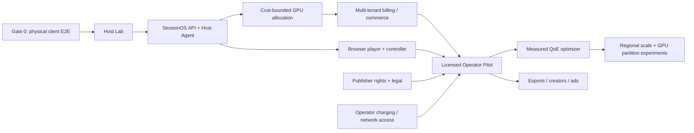

# Cloud Gaming Platform 2.0 — Delivery Roadmap & Work Breakdown Structure
**Status:** Proposed execution plan; estimates are indicative and dependent on team/rights/resources  
**Date:** 2026-10-26  
**Program master:** [PLATFORM_MASTER_PLAN_2026-10-26.md](PLATFORM_MASTER_PLAN_2026-10-26.md)  
**Handover:** [PLATFORM_HANDOVER_RUNBOOK_2026-10-26.md](PLATFORM_HANDOVER_RUNBOOK_2026-10-26.md)

## Usage
This is an issue-ready backlog with stable work-item IDs and explicit dependencies/acceptance. Convert each work item to a GitHub Issue and link the PR/CI/benchmark evidence when starting it. Status starts `NOT_STARTED` unless expressly marked `PARTIAL` or `PROVEN` with evidence.

**Definitions:** P0 = mandatory technical gate; P1 = operator pilot critical; P2 = differentiated scale; P3 = optional/research. Engineering calendar estimates are rough *elapsed* windows assuming parallel workstreams, not commitments. External licensing, operator access and hardware procurement can dominate timelines.

## 1. Workstreams and provisional responsibility

| Workstream | Owner role (assign person later) | Primary scope | Required collaboration |
|---|---|---|---|
| EX — Experience & Client | Client technical lead | Android/TV, web, desktop, input, UI | QE, Media, Platform |
| HS — Host & Streaming | Host/media engineer | Sunshine/Vibeshine adapters, capture, virtual display, gamepad | Cloud, QE, Legal |
| CP — Control Plane & Backend | Backend lead | auth, session state, entitlement, catalog, multi-tenant, billing | Cloud, Security |
| CO — Cloud & Infra | Cloud/SRE lead | GPU workers, images, IaC, queues, telemetry infrastructure | HS, CP |
| QI — Quality & Intelligence | QE/performance/analytics lead | test harness, QoE metrics, capacity model, recovery | All |
| OP — Operator & Commerce | Product/partnership lead | rights, operator contracting, charging, packaging, commercials | Legal, CP |
| LG — Legal/Security | Designated responsible roles | licenses, publisher permission, privacy, threat model, security review | All |

An 8–12-person cross-functional starting team is a planning scenario, **not an approved staffing level**. Name accountable owners before scheduling paid implementation. Separate business approval of cloud spends and rights from engineering access.

## 2. Dependency graph

**Hard guards:** no paid GPU simply for UI; no commercial user/game launch without rights/tenant segregation; no GPU-sharing claims before isolation stress testing; no automatic QoD promise before a network/operator trial; no experimental codecs in baseline client.

## 3. P0 — Physical client reliability and proof (weeks 1–3 planning)

| ID | Work package | Current status | Exit evidence |
|---|---|---|---|
| EX-001 | Freeze known-good 12.2 and 12.3 build provenance and rollback | PARTIAL | Immutable refs, hashes, CI run + emulator proof cross-linked |
| EX-002 | Run 12.3 APK on authorized physical Android phone | NOT VERIFIED | Device model, ABI, Android SDK, decoder hardware path, install/run and clock delta captured |
| EX-003 | Real Wi-Fi pair/play SuperTuxKart against local Sunshine | NOT VERIFIED | Video/audio/controls; startup and 60-FPS profile metrics; no stale clock |
| EX-004 | TV in-stream QR controller E2E with separate phone | NOT VERIFIED | QR opens without Game.onStop; user input reaches game; expiry/revoke; no disconnect |
| EX-005 | Auto/Fast/Balanced/Quality physical baseline | NOT VERIFIED | Repeatable per-profile telemetry with actual frame pacing |
| EX-006 | Exit/Disconnect/Resume/End regression 20 cycles | NOT VERIFIED | Host process/stream lifecycle and no input leak |
| QI-001 | Telemetry extraction and comparison report generator | NOT_STARTED | p50/p95, FPS distributions, encoder/decoder/network segmentation |
| QI-002 | Troubleshooting guide for pairing, clock skew, client/software decoder | PARTIAL | Scripted checklist, measured evidence, device matrix |
| EX-007 | Fix launch/card focus issues found on physical TV/phone | DEPENDS ON TEST | Issue-specific PR + green CI + real device run |

**Gate G0:** two physical device classes preferred (at least one Android phone and one Android TV/STB), stable game connection and verified lifecycle. Do not confuse emulator success with hardware acceptance.

## 4. P1 — Windows and Linux host laboratory (weeks 2–7)

| ID | Work package | Priority | Dependencies and acceptance |
|---|---|---|---|
| HS-001 | Snapshot local Sunshine install, apps config and logs | P0 | Preserve live known-good host before experiments |
| HS-002 | Pin stable Vibeshine lab version, validate packaging/driver trust | P0 | Isolated machine/VM; no replacement of primary Sunshine; rollback documented |
| HS-003 | Same-game A/B capture/encoder/frame pacing across Sunshine and Vibeshine | P0 | Same client/device/network/bitrate; encode, dropped frames, GPU, latency |
| HS-004 | Virtual display creation/verified teardown and orphan reclamation | P0 | 20+ create/disconnect/crash/cleanup tests |
| HS-005 | Gamepad VHF driver input semantics | P1 | Buttons/axes/rumble mapping tested; driver license/provenance |
| HS-006 | Playnite launcher/library adapter proof | P1 | Managed app launch, focus, clean close; not source of customer entitlement |
| HS-007 | Scoped host API authentication and audit | P0 | Least privilege, no blanket WebUI admin credentials |
| HS-008 | Headless Windows game-host lab | P0 | Works without interactive RDP; cold boot→game frames→shutdown |
| HS-009 | Linux host existing black-screen/SDL-Wayland issue repro | P0 | Exact logs, desktop/compositor/capture state and reproducible fix OR Windows-first pivot ADR |
| HS-010 | LuminalShine/LuminalVGD isolated research | P2 | Confirm tagged release artifact, source/driver build, license, GPU reset behavior; no production promotion |
| HS-011 | Host Agent contract/OpenAPI + capability flags | P0 | Idempotent prepare/display/launch/attach/end/cleanup and explicit unsupported |
| QI-003 | Forced process and encoder crash recovery tests | P1 | Bounded retries and terminal error, no endless worker cost |

**Gate G1:** independently reproducible headless session that starts/ends with clean virtual display/input state. Favor Windows initially if Linux still fails. Select one primary host plus fallback; do not merge whole forks.

## 5. P1 — Control plane, SessionOS and fleet (weeks 4–12)

| ID | Work package | Priority | Done means |
|---|---|---|---|
| CP-001 | Core domains, architecture ADR and OpenAPI schema | P0 | Account, tenant, game rights, entitlement, session, lease, billing events |
| CP-002 | Authentication broker and partner OIDC preparation | P0 | Identity tokens, operator tenant binding, session roles, revoke |
| CP-003 | Publisher/region game-rights manifest registry | P0 | Missing rights deny play; region and OS restrictions enforced |
| CP-004 | SessionOS state machine and durable transition log | P0 | Legal transitions only; timeouts, failure/recovery, duplicate requests |
| CP-005 | Atomic host/resource lease + bounded scheduler | P0 | No double allocation, stuck leases reaped, per-tenant quotas |
| HS-012 | Versioned Host Agent secure registration/heartbeat | P0 | Authenticated outbound link, health, capability updates and watchdog |
| CP-006 | Signed connect/reconnect/controller grants | P0 | Short expiry, host binding, ownership and revocation |
| CP-007 | Disconnect grace period and explicit End policy | P0 | State-aware billing and cleanup semantics |
| CO-001 | Infra as code for non-GPU control plane | P0 | Reproducible dev/stage with budget/identity/logging defaults |
| CO-002 | GPU golden image and install manifest | P0 | Pinned driver, verified game/host/agent, known image digest |
| CO-003 | Cost-bounded short-lived cloud GPU prototype | P0 | Budget tag, TTL terminator, manual spend approval, zero leaks |
| CO-004 | Readiness/capture/first-frame integrated gate | P0 | No session marked streamable before media path readiness |
| CO-005 | Save/profile segregation and secure cleanup | P0 | No cross-user data, encrypted authorized saves only |
| CP-008 | Usage event ledger + reconciliation | P0 | Correct consumption, idle/playing separation, retry-safe |
| CP-009 | Tenant-level quotas, rate limits, anti-abuse | P0 | No unbounded GPU start, controller/token abuse guard |
| QI-004 | End-to-end integration and fault injection | P0 | Duplicate, lost heartbeat, stale connection, revoked token |
| QI-005 | GPU and egress actual cost collector | P0 | Allocated vs useful play-hour, egress and idle tagged to session |

**Gate G2:** two different authorized users can obtain independent GPU sessions, play authorized titles, disconnect/end, and prove no user data/input/video crossover. Billing events reconcile to measured GPU/egress usage.

## 6. P1 — Product, operator and browser experience (weeks 7–16)

| ID | Work package | Priority | Acceptance |
|---|---|---|---|
| EX-008 | Unified product shell API and brand tokens | P1 | Partner brand config without APK fork per tenant |
| EX-009 | Server-backed curated catalogue and game metadata | P1 | Rights/region/device policy enforced on server |
| EX-010 | Browser WebRTC player technical proof | P1 | Audio/video/keyboard/mouse/gamepad under ICE/TURN test |
| EX-011 | Browser QoE telemetry and support diagnostics | P1 | Same session ID and correlated time to first frame |
| EX-012 | Native input-only companion controller v1 | P1 | Expiring QR grant, controller ownership, disconnect/revoke |
| EX-013 | Cross-device reconnect same host session | P1 | No unauthorized takeover; host retained by policy |
| CP-010 | Subscription/playtime passes/trials and entitlements | P1 | Server-side enforcement, balance/ledger and refunds |
| CP-011 | Operator billing adapter interface + test gateway | P1 | Idempotent activation, reversal, settlement reports |
| OP-001 | Pilot partner requirements workshop | P0 | Operator/territory/data/charging/edge capability confirmed |
| OP-002 | Pilot game rights and anti-cheat assessment | P0 | Written cloud rights and compatibility per title |
| OP-003 | Commercial price/SKU model | P0 | Contribution sensitivity on real cost estimates |
| EX-014 | Partner CMS v1 | P1 | Theme, titles, plans, reporting roles, localization |
| CP-012 | Partner dashboard + support traces | P1 | Tenant-safe drilldown, sessions, usage, error attribution |
| LG-001 | Security/privacy/license pilot review | P0 | Signed-off data, game rights, source obligations, privacy |
| QI-006 | Browser-vs-native A/B field tests | P1 | Same location/device-class, QoE and egress cost |

**Gate G3:** consumer can authenticate under pilot partner, find a legally enabled game, redeem an entitlement, play, receive a correct usage statement and get support. Browser trial can be deferred if native customer launch does not depend on it.

## 7. P2 — Network intelligence and operator pilot (months 4–6)

| ID | Work package | Priority | Acceptance |
|---|---|---|---|
| QI-007 | Client+host+network normalized telemetry schema | P1 | Versioned event format, consent & retention and cohort metrics |
| QI-008 | Deterministic QoE diagnosis rules | P1 | Decoder/network/encoder/capture faults distinguishable |
| QI-009 | Safe stream quality automation under guardrails | P2 | A/B improvement; no oscillation/bad-frame regression |
| QI-010 | Capacity demand forecast / warm-pool algorithm | P2 | Cost + start latency improved against fixed capacity |
| CO-006 | Regional placement policy and failover | P2 | Latency/cost/reliability tradeoffs measured |
| OP-004 | Operator SSO and charge integration pilot | P1 | Actual operator test accounts and reconciliation |
| OP-005 | Network measurement and QoD/edge API feasibility | P1 | Network/operator capability documented; avoid unproven promises |
| OP-006 | Partner unit economics and attribution report | P1 | Incremental vs cannibalized data contribution distinguished |
| QI-011 | Pilot SLOs, error budgets, on-call & escalation | P1 | Real incident drill and honest published SLA |
| LG-002 | Commercial distribution/license documentation | P0 | License compliance and publisher rights validated |

**Gate G4:** pilot demonstrates reliable user journeys, measurable QoE and sustainable contribution under defined adoption/utilization; a partner can see genuine network/product value.

## 8. P2/P3 — Ecosystem and scaling (after pilot proof)

| ID | Work package | Priority | Acceptance |
|---|---|---|---|
| EG-001 | Tournament/leaderboard API integration | P2 | Event-to-result audit trail and dispute workflow |
| EG-002 | Automated results from official game APIs | P2 | Rights/API scope and accuracy evidence |
| EG-003 | Screenshot/clip result extraction | P2 | Opt-in capture, confidence threshold and manual fallback |
| EG-004 | Creator/spectator grants and clips | P2 | Cannot inject unauthorized game input; consent and rights |
| EG-005 | Campaign/advertiser CMS and ad verification | P2 | No forced gameplay interruption, attribution and billing |
| EG-006 | Loyalty/rewards and referral ledger | P2 | Abuse-resistant, operator compatible |
| CO-007 | Validated GPU partition/VM-density experimentation | P2 | Security isolation + performance + rights + unit economics |
| CO-008 | Regional private GPU farm agent onboarding | P2 | Provider certification and health/charging integration |
| EX-015 | iOS/iPadOS, Windows and macOS expansion | P2 | Platform codec/input/store/privacy tests |
| EX-016 | Optional PyroWave/Vulkan/fast-VSync/LFR research | P3 | Stable baseline A/B and license/device tests |
| EG-007 | Optional GMRT wallet/reward adapter | P3 | Business/legal approval; no default wallet requirement |
| CO-009 | Custom D2E capture R&D | P3 | Quantified advantage worth maintenance cost |

## 9. Pilot budgets and hard stop conditions

**Approval-controlled budget dimensions** (assign actual numeric USD limits with sponsor before paid tests):
- GPU compute per day/week and absolute test TTL.
- GPU utilization/allocated-to-delivered play hour ratio.
- Data transfer to clients and TURN relay.
- Golden image EBS/snapshot storage, CI artifacts and metrics.
- Windows/driver/game licensing and third-party host/provider subscriptions.
- R&D engineer time and delayed publisher/operator dependencies.

**Automatic stop criteria:**
1. GPU instance exceeds authorized TTL or tag/budget; terminate after collecting non-sensitive logs.
2. Title fails explicit rights check: never open to commercial users.
3. Repeated black-screen/no-first-frame: stop provisioning additional GPUs and investigate root cause.
4. No verified host cleanup: block next user allocation.
5. Security isolation test fails: stop multi-user pilot.
6. Client codec/device safety regression: restore known-good app build.
7. Commercial session costs exceed approved envelope without economics review.

**No guessed USD totals** are presented as facts. Build financial estimates only from live provider quotes, specific geography, licensed games, selected GPU capacity and measured usage.

## 10. Testing matrix and evidence artifacts

| Matrix | Dimensions |
|---|---|
| Device | Android TV, physical Android phone, browser, future Windows/iOS |
| Network | Same-LAN, home Wi-Fi, cellular, operator access, constrained-loss/RTT test |
| GPU | Intel Iris Xe baseline, candidate dedicated/fractional NVIDIA cloud GPUs, partner edge |
| OS/host | Windows Sunshine stable, Vibeshine lab; Linux capture repro; LuminalShine research |
| Game | SuperTuxKart technical control; at least two additional authorized titles |
| Codec | H.264 primary; HEVC/AV1 where both sides support; experimental only in lab |
| Profile | Auto, Fast, Balanced, Quality |
| Lifecycle | Start, disconnect, resume, terminate, expired grant, preempted worker, crash |
| Input | TV/gamepad, phone QR, browser keyboard/mouse, input-only controller attach |
| Security | Tenant isolation, session grants, revoked account, impersonation attempts |
| Capacity | 1, 2, N independent users; concurrent admission races and cleanup |

Required evidence for each gate:
- date/time and environment manifest; actual commit/CI build; device/host model; GPU driver;
- logs/telemetry with secrets redacted; screenshots/video only with appropriate consent;
- failure/retry logs, open issues and root-cause notes;
- per-game cost estimates with source rates/time period;
- reviewer and result: `PASS | FAIL | BLOCKED | NOT TESTED`;
- next-gate approval and rollback instructions.

## 11. Architecture and product review checklist

- [ ] Product owner approves target pilot operator/region, commercial package and first games.
- [ ] Rights owner certifies permitted title/platform/territory cloud rights.
- [ ] Client lead approves physical Android baseline.
- [ ] Host lead chooses primary host from measured A/B and confirms rollback.
- [ ] Security approves signed session grant, control agent privileges, tenant separation.
- [ ] Cloud lead verifies GPU TTL, tagging, egress cost and shutdown.
- [ ] Backend lead approves SessionOS state transitions, API and billing idempotency.
- [ ] QA lead defines p50/p95 metrics and fault/cross-user test suite.
- [ ] Partner lead verifies network QoD/charging capability rather than assuming it.
- [ ] Legal validates GPL/AGPL/driver and privacy obligations.
- [ ] FinOps signs off cost/play-hour and proposed contribution margin scenario.
- [ ] Incident and handover runbooks tested by a second engineer.

## 12. Review process, changes and ownership

Use GitHub Issues with prefixes `EX-`, `HS-`, `CP-`, `CO-`, `QI-`, `OP-`, `LG-`, `EG-` and corresponding IDs above. Issue fields: description, owner, status, evidence link, dependencies, acceptance, tested commit/build, environment, risk, cost and rollback.

Suggested label taxonomy:
`phase/0` ... `phase/5`, `area/client`, `area/host`, `area/sessionos`, `area/operator`, `priority/p0` ... `priority/p3`, `gate/blocked`, `needs/licensing`, `needs/partner`, `needs/device`.

Pull requests must update either the program docs or the client canonical handoff whenever they change verified behavior. Keep issue status independent from specification status. At milestone close, attach evidence and a dated decision note.

**First work item to execute next:** `EX-002` / `EX-003` physical-phone stream baseline using the ADB-connected phone; complete `EX-004` to `EX-006` before any paid AWS GPU test.
