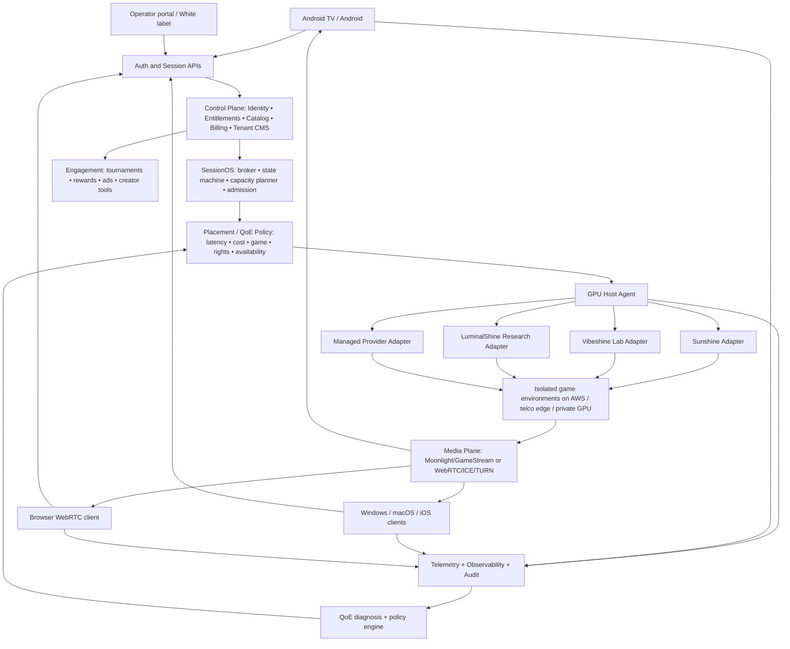
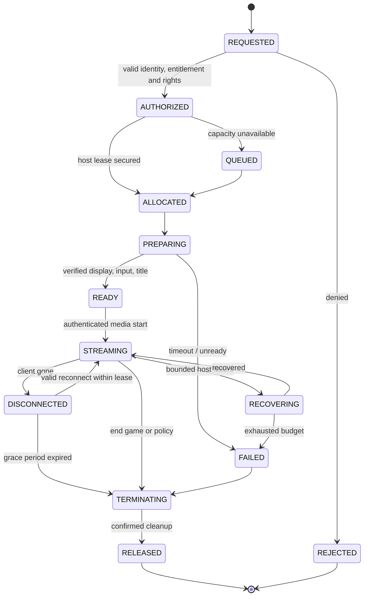

# Cloud Gaming Platform 2.0 — Master Product & Architecture Plan

> **CURRENT EXECUTION DECISION — 2026-10-27:** [Gaming-first MVP & Partner Demo](GAMING_FIRST_MVP_AND_DEMO_2026-10-27.md). Focus on actual physical Android client, minimal SessionOS, one remote licensed GPU game, real WAN/QoE/cost measurement and operator presentation. CPU/GPU desktop support belongs in the resource-class architecture but is not MVP scope. Earlier Chromebook education MVP is deferred.


**2026-10-27 economics review:** [Unit economics and recommended commercial entry](UNIT_ECONOMICS_MARKET_FOCUS_2026-10-27.md). It narrows near-term development toward partner-funded GPU capacity and productized instant demos; no presumption of market-validated pricing or signed demand.
**Status:** Proposed architecture / review baseline, not a claim of production implementation  
**Date:** 2026-10-26  
**Repository:** `atifbukhari/Cloud-Gaming-Client`  
**Authoritative client handoff:** [CANONICAL_HANDOFF_2026-10-23.md](CANONICAL_HANDOFF_2026-10-23.md)  
**Executable roadmap:** [PLATFORM_DELIVERY_WBS_2026-10-26.md](PLATFORM_DELIVERY_WBS_2026-10-26.md)  
**Operational handover:** [PLATFORM_HANDOVER_RUNBOOK_2026-10-26.md](PLATFORM_HANDOVER_RUNBOOK_2026-10-26.md)  
**Sources/decision ledger:** [PLATFORM_DECISIONS_AND_SOURCES_2026-10-26.md](PLATFORM_DECISIONS_AND_SOURCES_2026-10-26.md)

> **Document hierarchy:** This is the strategic/technical product plan. The existing dated CANONICAL_HANDOFF remains authoritative for *verified Android client build/test state*. A future operator/platform repository may become the program-level system of record once established. No deployed capability, GPU capacity, licensing authorization, or performance metric should be inferred from a proposed section.

## 0. Executive product decision

Build **a telco- and operator-ready cloud gaming experience platform**, rather than a proprietary codec project or a branded Moonlight client only.

**Positioning:** One platform, any supported screen, authorized games, intelligent streaming placement, telecom and partner monetization.  

We own differentiation in five areas:
1. **SessionOS:** secure game entitlements, GPU allocation, game-ready provisioning, session leases, persistence, cleanup, recovery, capacity and metering.
2. **Cloud Gaming Network Intelligence:** client/host/network quality telemetry, device-specific tuning and network-aware placement with an optional telco integration layer.
3. **Operator Platform:** configurable brands, operator SSO, charging, bundles, catalogue restrictions, analytics and support.
4. **Accessible multi-screen experience:** Android TV/mobile first; browser and desktop next; QR companion phone input and optional device continuation.
5. **Gaming ecosystem:** authorized games, tournaments, creators, instant trials, loyalty and sponsorship without making any of these prerequisites for starting a session.

Reuse Moonlight, Sunshine and relevant upstream forks for streaming mechanics where proven. Do **not** fork and maintain three competing host engines. Build adapters and measure them.

### Product lines and commercial customers

| Offering | Buyer/user | Value | First launch |
|---|---|---|---|
| Cloud Gaming Consumer | Subscribers via operator/partner | Game access on existing devices, simple controller options | First commercial pilot |
| Cloud Gaming Operator | Telecom, ISP, data center, B2B2C distributor | White-label service, network integration, charging, reporting | **Primary sales vehicle** |
| Instant Experience | Publisher, event, advertiser, tournament organizer | Browser or embedded game trial, promotions, esports engagement | Second track, later |
| Managed GPU Platform | Regional hosts/enterprises | Managed host/session orchestration APIs | Extension after real ops proof |

Business proposition: sell the service/control plane and operator integration; do not claim a broad AAA catalogue without permissions and viable economics.

## 1. Confirmed baseline and known gaps (as of 2026-10-26)

### Verified / evidence-backed from our project
- Android/Android TV client is a Moonlight Android-derived branded fork, repository branch `demo-client-v1`.
- Immutable local E2E rollback branch: `demo-client-v1-e2e-green-2026-10-23` at its recorded checkpoint. Do not alter it.
- Custom **12.2-demo2** APK was tested on an **Android TV emulator** with a local Windows Sunshine host: pairing, SuperTuxKart stream display, telemetry, Disconnect, Resume, End Game and host game termination.
- 12.3-demo2 UI/profile/QR work is committed with successful GitHub Actions preflight/APK build as documented in the canonical handoff. **CI success is not physical-hardware acceptance.**
- A physical Android phone was ADB-authorized in the conversation, but complete physical-client decode/control/stream acceptance has **not yet been recorded**.
- Emulator software H.264 decoding and local-Wi-Fi round-trip timings are **not end-to-end customer latency benchmarks**.
- Prior Linux/AWS headless gaming black-screen/capture issue remains a separate unresolved production blocker.
- No paid AWS GPU capacity is to be started solely for UI work; confirm real resource state before deployment.

### Not proven / not yet implemented as a product
- Commercial GPU broker, entitlement/token broker, multi-tenant user isolation, gaming billing, publisher cloud rights, hardened input-only controller bridge, encrypted save persistence, partner CMS/SSO, browser player, operator network QoD, live QoE optimizer, GPU sharing at commercial economics, production SLOs.
- Benchmark claims from upstream host forks are **candidates**, not our measured results.
- Multi-monitor support is not independent multi-user GPU isolation. Never infer safe independent users per GPU from display count.
- The product does not currently have an unrestricted library of legally deployable commercial games.

### Verified code/build references
- Repo: https://github.com/atifbukhari/Cloud-Gaming-Client
- Active branch: `demo-client-v1`
- Known baseline checkpoint details and CI runs: [CANONICAL_HANDOFF_2026-10-23.md](CANONICAL_HANDOFF_2026-10-23.md)
- Physical test guide: [PHYSICAL_ANDROID_VALIDATION.md](PHYSICAL_ANDROID_VALIDATION.md)
- Stream profiles: [STREAM_PROFILES.md](STREAM_PROFILES.md)
- CI: [CI_BUILD_STRATEGY.md](CI_BUILD_STRATEGY.md)
- Upstream feature provenance: [UPSTREAM_FEATURE_REFERENCES.md](UPSTREAM_FEATURE_REFERENCES.md)

## 2. Non-negotiable architectural principles
1. **Control/media separation:** APIs authorize/prepare/measure sessions; gameplay video, audio and input use a specialized real-time path, not generic API proxying.
2. **Replaceable host adapters:** proprietary business state is outside Sunshine, Vibeshine, LuminalShine or a managed service. Unsupported host capabilities are explicit.
3. **One dedicated isolated environment per player initially:** GPU sharing only after testing security, licensing, performance and cost.
4. **Native media path:** keep decoded video in hardware-native rendering; a React/CEF shell may surround it but must not force frame-by-frame Chromium compositing.
5. **Single source of entitlement:** billing/subscription and publisher-permission checks are server-side. Client state is advisory.
6. **Automated, bounded recovery:** each retry has a state, deadline and audit trail. No endless recovery loops or unbounded GPU spend.
7. **Least privilege:** signed short-lived connection grants; tenant-scoped service identities; no streaming-host admin password in an APK.
8. **Reversible changes:** preserve known-good baseline; introduce frame-pacing, decoder and host upgrades in feature-gated labs.
9. **Privacy-by-design:** publish anonymized QoE aggregates; do not record gameplay/screen/video or player keystrokes by default.
10. **Rights before launch:** only host titles/launchers where publisher, storefront, anticheat, cloud use and region allow the exact offering.

## 3. Logical reference architecture



**Deployment distinction:** diagram is logical, not a requirement to deploy every box as an individual microservice. Initially a modular monolith for commercial APIs, with separate SessionOS worker/agent and telemetry pipeline. Split services only for scale/failure-domain reasons.

## 4. Experience and client architecture

### Platform sequence
1. **P0 Android TV + Android phone/tablet**: existing codebase; device-family adaptive UI; native MediaCodec path, Android input/haptics as supported.
2. **P1 browser**: WebRTC player for trials, customer acquisition and platform embedding; implement browser keyboard/mouse/gamepad/touch support and TURN where necessary.
3. **P1 Windows desktop**: Moonlight Qt-derived native streaming core + branded shell; Windows-native gamepad and input.
4. **P2 iOS/iPadOS and macOS**: native iOS/Moonlight and macOS-based clients respecting platform APIs, distribution and business rules.
5. **P2 other smart TVs and Linux desktops**: platform-by-platform feasibility; use WebRTC when hardware/DRM/input/browser support is demonstrated.

### Common experiences
- Product-shell API/SDK: catalog, account, game page, session state, entitlement, settings, operator theming, localization, account support and telemetry.
- Hero game catalogue with cover, allowed region/platform, Play/Resume, stream profile, title/rights metadata and clear access requirements.
- In-stream action panel: Resume; Controller (Bluetooth, touch, QR phone); keyboard/mouse; audio; diagnostics; Disconnect; End Game. Do not pause/kill the stream when overlaying phone QR.
- Profiles: Auto (preserve compatibility), Fast, Balanced, Quality. Baseline 12.3 profiles map only existing frame-pacing behavior; do **not** imply adaptive codec/bitrate is already implemented.
- Companion controller: QR grants a **session-scoped, user-approved, expiring** input-only capability. Move from demo LAN keyboard mapping to server-authorized control/data channel with proper gamepad semantics, ownership, rate limits and revoke.
- Session handoff: same running host session can reconnect from a second device where auth and host support it; never promise live process migration between GPUs.
- Instrument launch delay, time-to-first-frame, decoder name, rendered/incoming FPS, dropped/duplicated frames, FPS percentiles, encode/host latency, jitter, RTP loss, input-to-photon measurements and crash/recovery events.

### Fork-porting policy
Use Starwire, Moonlight X, Artemis and Artemide as references for game-first UI, overlay and input UX, per-app settings, pacing, LFR, async decode and Vulkan/direct rendering. Copy code only with documented exact source commit/path, applicable license notices and compatibility tests. Keep experimental codecs (PyroWave) and vendor Turnip in the performance lab; do not elevate based on screenshots or subjective feel.

### CEF/React correction from older scope
Original scope proposes CEF + React across all platforms. Keep shared UI schemas/design tokens and React for web/CMS/desktop shell where efficient, but do **not** require embedded desktop CEF on Android/iOS. Use native UI and WebView/WKWebView for permitted commercial content; native render surfaces for game video.

## 5. Host and game-environment architecture

### Host Agent (our owned IP)
A trusted service running on the game environment, with short-lived machine identity and outbound control-plane link:
- gather actual encoder, display and game-launch capability (not guessed from host product name);
- prepare, launch, inspect and terminate **authorized** games through supported launcher adapters;
- create/attach/delete virtual display if host supports it; verify topology actually applied;
- map paired client/session to resource-owned game processes;
- establish gamepad/keyboard/mouse device ownership and optional secondary controller inputs;
- emit health, game/process, capture, encode and GPU metrics;
- manage a bounded recovery ladder and clean release;
- refuse requests not bearing valid signed/session-scoped permissions;
- enforce no cross-tenant access and no unapproved arbitrary command execution.

### Host adapter contract (versioned and capability-driven)
```text
getCapabilities(hostId) -> codecs, capture, input, virtualDisplays, WebRTC, HDR, resume
prepareSession(sessionId, config) -> readiness / failure reason
createDisplay(sessionId, modes) -> displayId / verified actual mode
launchGame(sessionId, gameInstallId) -> launchId / process
getHealth(sessionId) -> session & capture/encode diagnostics
attachPlayer(sessionId, grant, profile) -> media endpoint metadata
attachController(sessionId, grant, controllerRole) -> input-only attachment
disconnectPlayer(sessionId) -> retained / released
terminateSession(sessionId) -> game closed + displays/input removed
cleanupSession(sessionId) -> verified idempotent cleanup
recoverSession(sessionId, recoveryStep) -> bounded recovery result
```
Actions must include `idempotency_key`, `deadline`, `tenant_id`, `session_id`, trace ID and audited operator identity. Every adapter returns `unsupported` rather than simulating a feature.

### Host engines
- **Sunshine:** current local E2E control; production-compatibility fallback.
- **Vibeshine:** evaluate in isolated Windows lab (native virtual displays, display restoration, gamepad VHF, scoped APIs, WGC capture, Playnite/library automation, optional Linux beta). Test stable, pinned releases, not nightlies by default.
- **LuminalShine:** optional research Windows host for D2E, virtual display and browser WebRTC; do not depend on its vendor-specific display stack until independent hardware/OS/driver and license validation. Its LuminalVGD driver is separately AGPL/commercial dual-licensed; repo claims and release packaging must be independently reconciled.
- **Managed provider:** evaluate services such as GameLift Streams as buy-vs-build and browser-trial benchmark, with explicit integration economics and content rights.

### Game runtime and images
- Golden Windows game-ready images with pinned GPU drivers, signed host-agent build, launcher and monitoring; separate Linux native/Proton work where compatible.
- Versioned game-manifest schema: rights, regions, OS, binaries, launcher dependencies, anti-cheat, save policy, CPU/RAM/VRAM, disk, controller mapping, cloud entitlement.
- Immutable images plus writable per-user sandbox; user saves in encrypted scoped storage, synced only after integrity/authorization checks.
- Start with SuperTuxKart and explicitly authorized additional light titles; publisher partnerships expand the catalogue.
- Display-driver and host upgrades require a safe backup, rollback and scheduled lab tests. Never perform unplanned in-place host swapping on the proven demo machine.

## 6. GPU infrastructure and scheduling

### Infrastructure tiers
| Tier | Purpose | Policy |
|---|---|---|
| AWS GPU (regional) | First provisioning tests, initial pilots, overflow | Use short-lived lab workers, firm spend caps and explicit cleanup |
| Telco or edge data center | Longer-term economics, lower path latency, network integration | Onboard as a capacity provider via Host Agent |
| Partner/private GPU farm | Tenant dedicated or sovereign deployments | Same agent, security envelope, provisioning & reporting |

AWS G6/G6e/G6f GPU capacity can be **evaluated** against games, memory, region and licensing; no assumption of present region availability or price. Spot is appropriate for rendering/batch, **not a normal uninterruptible customer game session** without a clearly disclosed interruption/recovery policy.

### Isolation levels
- **First release:** one player/tenant-authorized process environment and its own host/user state per VM/worker. Treat this as the proven security model only after testing.
- **Later:** GPU partitioning with independent VMs/containers when graphics/video encoder support, OS licensing, drivers and game anticheat permit it.
- **Experimental:** multiple displays/users sharing one OS session. This does **not** imply security separation. Forbidden for unrelated paying users until independent isolation/security validation.

### Placement model
Hard filters BEFORE optimization: publisher entitlement, region, game OS/anticheat, machine capacity, codec, license and isolation. Rank the rest by weighted latency, reliability, GPU cost, network egress and warm-start penalty. Scoring parameters are configurable and audit-logged.

```text
candidate_hosts = filter_by_rights_region_hardware_isolation_and_health()
eligible = filter_by_current_capacity(candidate_hosts)
best = minimize(weighted(network_latency_p95, GPU_cost_per_expected_playhour,
                         expected_start_delay, historical_failure_rate,
                         egress_cost, carbon_or_partner_policy))
```

No hardcoded multiuser-per-GPU count. Estimate concurrent sessions with real game/VRAM/encoder measurements and per-title admission policies.

### Capacity states
`COLD → BOOTING → READY_WARM → ALLOCATED → STREAMING → DRAINING → SANITIZING → READY_WARM or OFF`. Separate per-host and per-session state. Warm pool size derived from arrival rates and cold boot/start times; shut down after idle timeout under budget policy. Put region/tenant quotas and circuit breakers on provisioning.

## 7. SessionOS: end-to-end lifecycle



### Required contracts
- Identity/entitlement is checked at both admission and token issuance; publish revocation.
- Session grant embeds scoped session/host/client role and short expiry, not host administrator credentials.
- Resource reservation is atomic; no duplicate GPU allocation on retries. Outbox/event log for state transitions and metering.
- Disconnect != End Game. Disconnect may retain resources with a clearly surfaced countdown; End Game closes game and begins immediate cleanup.
- Reconnect rotates credentials, revokes old connection rights if exclusivity policy requires and verifies same session ownership.
- No account cross-contamination. Wipe temporary user state while retaining only consented encrypted saves.
- Reap orphan leases after missing heartbeats; billable end and cleanup timestamp are separately captured for audit.
- Session control and media status both required to declare READY/STREAMING; host process present alone is insufficient.

### Minimum control plane APIs (draft; schema/OpenAPI required in implementation)
```text
POST   /v1/sessions                   idempotent request + admission
GET    /v1/sessions/{id}              state, safe error, queue/grace metadata
POST   /v1/sessions/{id}/connect      short-lived stream credential
POST   /v1/sessions/{id}/disconnect   keep-alive policy
POST   /v1/sessions/{id}/end          close / cleanup
POST   /v1/sessions/{id}/controller   input-only grant & QR token
DELETE /v1/sessions/{id}/controller/{grantId}
GET    /v1/catalog                   tenant/territory/right filtered
GET    /v1/devices/{id}/profiles      capability-based policies
GET    /v1/session-events/{id}        tenant/admin scoped summary
```
Host Agent API remains internal, mutually authenticated, rate-limited, audited.

## 8. Media delivery and latency

Two media paths:
- **Native Moonlight/GameStream:** initial competitive low-latency gaming, hardware codec negotiation where client/host support it; direct UDP path or permitted relay architecture, authenticated pair/session.
- **Browser WebRTC:** instant trials/embedded portals, ICE/STUN/TURN, frame-accurate input channels where possible, browser codec/hardware/permission tests. TURN egress is a first-class budget component.

The business/control API does not carry encoded gameplay frames. Controller input remains cryptographically session-scoped and server-authorized. A spectator broadcast is a **distinct permissioned broadcast/recording pipeline**, not another unrestricted game-control connection.

Measure full **input-to-photon** on physical devices; RTT alone is not an end-to-end latency metric. Separate encode, capture, network, decoder queue, rendered vs incoming FPS and display refresh pacing. Compare p50/p95 by device, game, stream profile and network.

## 9. QoE intelligence and automated operations

### Phase 1 deterministic engine
Collect client NDJSON schema version history plus host traces into a unified event envelope:
`tenant_id, user_pseudonym, session_id, region, host_id, game_id, timestamp, stream_profile, decoder, capture_type, encoder, codec, resolution, requested_fps, rendered_fps, network_rtt_ms, jitter_ms, packet_loss, encode_ms, decode_ms, session_state, error_code, build_id, trace_id`.

Apply privacy and retention controls and avoid collecting keystrokes, full game video or sensitive content by default.

Rule-based diagnosis examples:
- Incoming 60 FPS but displayed 24 FPS + high decode → likely client decoder/rendering.
- Decoder healthy but host capture stalled → likely capture/virtual display.
- RTT/jitter/loss spike with stable encode/decode → likely network route/congestion.
- Launcher exits immediately/anti-cheat blocks → game compatibility; don't keep trying arbitrary fixes.

Action hierarchy: observe → safe profile adjustment → reconnect suggestion → bounded capture/adapter recovery → terminate & explain → human escalation. All actions traceable and reversible. Later train demand forecasting or profile selection from validated data; LLMs can summarize incidents, not directly send arbitrary privileged shell commands to production GPU hosts.

### Telco integration
An operator adapter may support OIDC/SSO, entitlement, network availability, QoD APIs, edge discovery, mobile gaming data bundles, operator charging, support workflows and partner dashboards. **Do not market guaranteed QoS absent deployed network capabilities and a signed SLA.** Evaluate routing/peering/path metrics and controlled trials.

## 10. Commercial/white-label platform

Tenant configuration includes: brand/theme/logo/domain/localization, permitted territories, game manifests/rights, pricing/plan/SKU definitions, entitlement mapping, network options, marketing, ads, support, reconciliation, reporting and feature flags. No tenant may self-enable a game without approved rights evidence.

Core services:
- Identity broker with per-operator OIDC/SAML where needed; user vs device vs controller roles.
- Catalog and content-rights registry, versioned by region and license.
- Commerce and ledger: subscription, prepaid playtime, vouchers, operator billing, promotions, refunds, settlement, overage and idempotent billing.
- Partner CMS/API plus feature flags.
- Support portal: session trace, reproducible logs, safe end/recover, billing explanations.
- RBAC/ABAC, tenant-bound data separation, consent, retention, audit.
- Analytics for acquisition, activation, first playable, session quality, play hours, retention, churn, unit margins and attributed operator revenues.

**Revenue measures must separate actual incremental gaming revenue and contribution from reclassified/substituted ordinary data bundles.**

## 11. Engagement, tournaments, creators, ads and optional tokenization

These are separate bounded-context modules, not dependencies for STREAMING state:
- **Tournaments:** registration, team rosters, scheduling, brackets, room metadata, APIs/screenshots/results, automated extraction where authorized, confidence scoring and human dispute/audit. Reuse relevant existing esports modules.
- **Creators:** spectator grants, opt-in clips, recording pipelines, AI-assisted highlights, publishing permissions; default off for recording.
- **Advertising:** pre/post-session, catalogue placements and voluntary rewarded formats; central campaign and eligibility service; independently verified impression events; **do not abruptly interrupt a live game for ads**.
- **Rewards/referrals:** operator-backed loyalty, gameplay achievements, promotions and partners.
- **GMRT/wallet:** optional wallet link, token reward or settlement provider and audited on-chain recording only with legal/commercial approval; no wallet required for access; staking and any financial-return products are out of MVP scope and require jurisdiction-specific legal review.

Original uploaded scopes are retained as *input*, not treated as proof these services exist. See source/decision ledger for traceability.

## 12. Data, services and implementation preferences

| Component | Initial implementation | Evolution criterion |
|---|---|---|
| Commercial/control APIs | Modular Go or .NET codebase, OpenAPI contracts | Split services only with demonstrated failure/load boundary |
| Session broker/agent | Dedicated strongly typed service + auditable state machine | Multi-region active/active after correctness proof |
| Primary DB | PostgreSQL: tenants, rights, subscriptions, sessions, ledgers | Strong partitioning and backups |
| Cache/locks | Redis where needed, not source of truth | Managed/HA after fault testing |
| Eventing | Transactional outbox + queue/event bus | Durable transport with retries/DLQ |
| Blob/store | S3 or provider-neutral object storage: images, authorized saves, captures | Scoped encryption and lifecycle |
| Telemetry | OpenTelemetry ingest + metrics/logs/traces + analytical sink | Sampling/privacy/retention policy |
| GPU workload | EC2/VM golden images + Host Agent, managed registry | More sophisticated scheduling only after evidence |
| Non-GPU services | ECS/Fargate/containers or conventional deployment | Kubernetes optional, not mandatory |
| Secrets | Cloud KMS + managed secret store | Tenant/provider scoped |
| IaC/CI | Terraform and GitHub Actions | Proven rollback and promotion |
| UI/CMS | React/Next.js | Multi-tenant experience templates |

Cost/inventory reporting must include GPU runtime **and idle hours**, bandwidth including TURN and Internet egress, storage/IO, licenses, payment fees, support, allocated-but-no-play sessions and refunds.

## 13. Security, isolation, governance and game rights

### Required security controls
- Per-tenant identity boundaries and authorization at every API; service-to-service mTLS; audit all host actions.
- Signed, short-lived player and controller grants; pair host identity to allocated session; kill old sessions on revoke where policy dictates.
- No hardcoded host PIN, credentials, device identifiers, JWT secrets or tokens in source, telemetry or QR screenshots.
- Isolated per-user environment; host VM sanitization and save sync before reuse. Security tests against cross-session input/video/audio and data leakage.
- GPU hosts cannot reach customer control DB directly; use scoped agent API.
- DDoS abuse, botting, controller input floods, fraud, payment chargebacks, adversarial game installations and host escape addressed with rate limiting and network segmentation.
- Family and minor accounts, consumer privacy, data residency and recording consent planned at tenant level.

### Legal/licensing gates
- Game purchase != commercial cloud execution permission. Maintain a **rights matrix** by title/region/operator/storefront/game cloud contract.
- Test anticheat, cloud virtualization policy, launchers and peripheral requirements per title.
- GPL-3.0 obligations apply to client/host derivative distribution; maintain source/NOTICE/provenance records.
- LuminalVGD claims dual AGPL-3.0/commercial licensing; do not bundle/link into proprietary commercial delivery without a legal determination or license.
- Validate OS, virtualization, GPU driver and game image license terms before commercial pilot.
- No console-farm offering implied by this architecture.

## 14. Cost, operations and commercial economics

```text
allocated_capacity_hour_cost = GPU_hourly + OS/host licensing + infrastructure overhead
delivered_playhour_cost = (allocated_capacity_cost + egress + relay + storage
                           + game licensing + payment + support + refunds)
                          / successfully delivered play-hours
contribution_per_paid_playhour = recognized revenue per paid play-hour
                                 - delivered_playhour_variable_cost
```
Illustrative video *payload* at steady 15 Mbps: approximately 6.75 GB/hour; overhead, bitrate variation, FEC and retransmissions change actual billable transfer. Never infer network cost from payload alone. Separate warm pool utilization, concurrency factor, trial→paid conversion and active playtime.

### Experiment-led financial gates
- Measure cold boot, game readiness, warm-start start delay and session success.
- Compare per-game GPU type/fraction and encoder VRAM, CPU, FPS, frame-time and cost.
- Experiment on stream bitrate ladders including high jitter and constrained bandwidth.
- Model telco peering/edge route economics by country/operator, plus negotiated minimum commitments.
- Require positive contribution at *realistic* utilization for each proposed pricing SKU before scale commitment.
- Sensitivity: egress, GPU effective rate, idle/warm allocation, game licensing, user playing time, abandoned starts, concurrency, refunds.

## 15. Quality targets and gates (proposed, NOT current SLAs)

| Metric | Candidate initial gate | How to validate |
|---|---|---|
| Local physical play | 720p60 and 1080p60 where hardware supports | Phone/TV E2E test, stream recording, decoder stats |
| Warm allocated first playable | Target <30s (not promise) | API request → confirmed first rendered frame |
| Controlled successful launches | Target >=99% on test set after hardening | Distinct attempts/unique request IDs |
| Input-to-photon | Measure p50/p95 and segment by geography | Hardware-camera/button rig plus timestamps |
| Dis/Resume/End | Correct cleanup and retain policy | Repeat automated loops and host process audit |
| Multi-user isolation | Zero cross-user video/audio/input/save exposure | Red-team and fault injection |
| Host cleanup | Zero leaked managed displays/gamepads/processes | Host agent inventory + teardown assertion |
| Economics | Positive contribution at modeled utilization | Cost ledger + real traffic/playing data |
| Operator reliability | Set pilot SLO after field data | Error budget and incident review |

## 16. Roadmap narrative and hard dependencies

**Phase 0 — Physical client acceptance (weeks 1-3 planning):** validate 12.3 on real phone and Android TV; host clock, pairing, hardware decode, audio/gamepad, QR companion, profiles, lifecycle. No paid AWS GPU.

**Phase 1 — Host lab (weeks 2-7):** Sunshine reproducible Windows baseline and Linux headless repro; isolated Vibeshine stable-release comparison; virtual display restore, gamepad, API/scoped auth, host failure recovery. Do not disturb primary Windows test host; LuminalShine remains a research lane.

**Phase 2 — SessionOS MVP (weeks 4-12):** service identity, entitlements, host agent, session state machine, allocation, lease/reap, restricted launcher, encrypted saves, usage ledger, simulated multi-user tests, scoped media tokens.

**Phase 3 — Consumer/operator MVP (weeks 7-16):** CMS, customer brand, pricing/entitlement flows, game rights registry, support admin, instant WebRTC browser trial, basic partner/tenant setup.

**Phase 4 — Network intelligence + telco pilot (months 4-6):** QoE policies, quality-adaptation rollout, operator SSO/charging, network signal integration where enabled, capacity forecasting and latency route experiments.

**Phase 5 — Engagement/scale (after pilot proof):** esports automation, creators/highlights, ads/rewards, wider regional edge/GPU sharing experiments, conditional token integrations.

Full work packages, acceptance gates, dependencies and role ownership: [PLATFORM_DELIVERY_WBS_2026-10-26.md](PLATFORM_DELIVERY_WBS_2026-10-26.md).

## 17. Pilot definition

The first pilot is deliberately constrained:
- one partner/operator, one region, one or two host environments;
- Android TV and phone clients; browser trial can be gated by a separate release;
- small legally authorized catalogue; SuperTuxKart as technical control, not proof of sellable game rights;
- limited subscribers; one allocated independent gaming environment per authenticated session;
- robust launch/end/reconnect, usage meters, support dashboard and QoE;
- one supported payment or operator entitlement flow; operator analytics and partner configuration;
- deterministic recovery and explicit incident runbook.

Exit the pilot only with: real video/device metrics, supported game rights, secure isolation, economic contribution model with measured costs, approved operator billing reconciliation, observability and rollback drills.

## 18. Market differentiation and defensibility

Rank differentiators by operator defensibility and effort:
1. **Telco/edge/network integration**: relationships, peering, subscriber identity, bundles, route/QoD observability.
2. **SessionOS + economics**: reliable GPU provisioning, auto shutdown, admission rights, cleanup, multi-provider, verified cost/play-hour.
3. **Fleet-wide QoE intelligence**: diagnostics and safe adaptation across game, network, client and host.
4. **Accessible living-room gaming**: phone-as-controller, simple TV UI, handoff from TV to phone.
5. **Gaming engagement / creator economy**: integrated competitions, opt-in highlights and rewards, partner campaigns.
6. **Advanced media optimization**: selective client/host improvements only when measured—not an automatic moat.

Resist direct comparisons to GeForce NOW's catalogue or a promise to stream personally owned console games until legal and game compatibility are addressed. Our sales pitch: an **operator-ready software and intelligence platform**, with multiple infrastructure economics and experience models.

## 19. Program operating model and handover

- Preserve active `demo-client-v1` as the client development branch; preserve immutable rollback branch.
- Do not create a second authoritative Android client runbook. This program plan **links** to the canonical client handoff.
- Create dedicated repositories or folders for `platform-control`, `sessionos`, `host-agent`, `web-player`, and `operator-portal` when first code is written; record owners, schemas, CI and rollback.
- Every delivered slice: ADR, code PR, unit/integration tests, field validation, feature flag, telemetry, cost effect, rollback, license provenance.
- Every experiment: hypothesis, baseline, sample/device/network, test script, pass/fail, result, promote/rollback decision.
- Maintain a reviewable decision register and risk/issues ledger, updated with each milestone.
- For operator trial handover: topology diagram, versions/commits, accounts/secret locations (not values), DNS, provisioning steps, price & cost guardrails, game rights records, support escalation, SLO/metrics and cleanup drill.

## 20. Review questions requiring product/business decisions

Unapproved/open, do not imply resolved:
1. Which operator and territory is Pilot 1? What data/edge/SSO/charging integration is actually accessible?
2. Is the target first offer a subscription, time pass, bundled entitlement or instant-play trial?
3. Which titles have **documented** commercial cloud-hosting rights and compatible terms?
4. What pilot budget and maximum GPU/egress monthly cap is authorized?
5. Preferred pilot geography/host OS, cloud region and expected concurrency?
6. Do we commit to Windows game hosting for v1, or retain Linux test-only until capture is fixed?
7. What is the minimum official platform surface at launch: Android TV + phone, browser later?
8. Are production code distribution and commercial host driver licenses compatible with desired IP strategy?
9. Who owns security review, publisher rights, partner pricing and support escalation?
10. Which per-operator SLA and data-retention policy are acceptable after field testing?

**Default action until answered:** continue local device acceptance and cost-bounded session-control scaffolding, not speculative paid infrastructure expansion.

---

**This plan is a specification and prioritization baseline.** Evidence, confirmed implementation state and operational commands live in the linked handoff and validation documents. A project never becomes "done" because it is described here.
